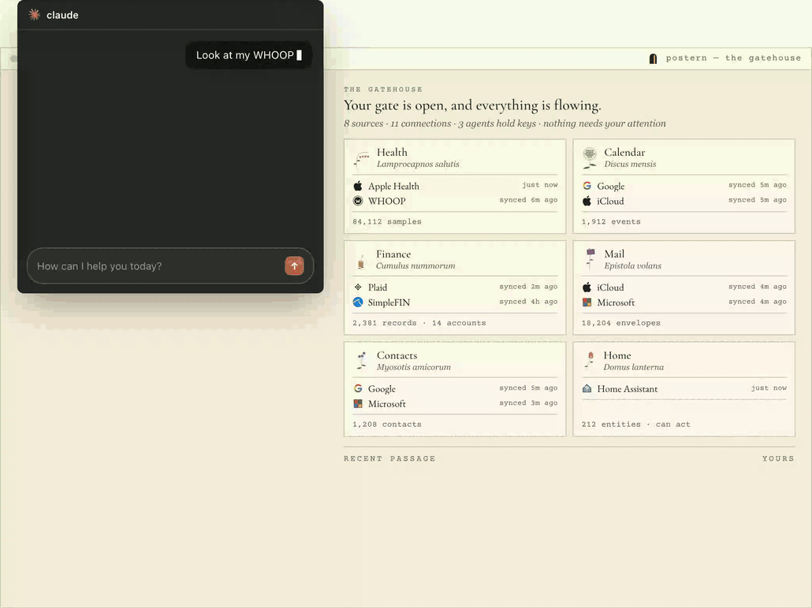

# Postern

**The Personal Context Gateway.** Connect the sectors of your life once — finance, health, mail, contacts, calendar, home — and reach them from *any* agent through one surface. Read them, and act on them where the source allows.

Postern runs on your own machine, and there is nothing in the middle: no account, no sign-up, no model provider in the loop, no correlation across your domains behind your back. Nothing leaves the box unless you ask it to.

**[getpostern.com](https://getpostern.com)** is the front door — the live demo, and a field guide for every provider.

## Set it up

Postern runs on any computer that stays on — the one in front of you, or a spare machine at home. Two ways in.

### With your agent

This is the path Postern was built for. Point your coding agent — Claude Code, Cursor, Codex, anything that can read files and run commands — at [`setup-with-your-agent.md`](setup-with-your-agent.md) and say:

> Follow https://raw.githubusercontent.com/getpostern/postern/main/setup-with-your-agent.md and set Postern up for me.

That file is a contract, not a tutorial — every step marked human or automatable, every command read from the gateway's own source, the whole path executed end to end by a first-time user's agent on a clean machine. The agent does about 95% of getting Postern running, Docker included. You do the parts only you can: signing in to your accounts and approving what they share. Secrets go into Postern's own screens, never into the chat.

### By hand

Install [Docker](https://docs.docker.com/get-docker/) first (free; its site walks you through it). After that it's three lines and about five minutes — fetch Postern, give its database a password of its own, start everything:

```bash
git clone https://github.com/getpostern/postern.git && cd postern
echo "POSTGRES_PASSWORD=$(openssl rand -hex 24)" > .env
docker compose up -d
```

Now open **<http://localhost:8787>** in your browser. That page is the Console — your gate's control room. It walks you through connecting your first source, and [the field guides](https://docs.getpostern.com) walk every provider screen by screen, with pictures.


*The Gatehouse — a real gate with four sources connected, everything freshly synced. This is `localhost:8787` once your first sources are in.*

Three things worth knowing:

- **The password line** writes a safe random password into `.env`, where every later start finds the same one — the database keeps the first password it is ever given.
- **Using it from another machine?** The Console answers only on its own machine, by design. `ssh -N -L 127.0.0.1:8787:127.0.0.1:8787 <your-box>` brings it to your laptop; everything else — your phone's health data, hosted agents like claude.ai and ChatGPT — goes over [Tailscale](https://tailscale.com), all opt-in. [`docs/SETUP.md`](docs/SETUP.md) § Remote access walks each tier.
- **What did you just install?** One published, signed image (`ghcr.io/getpostern/postern`) and a database, listening only on `127.0.0.1`. Only `docker-compose.yml` is truly needed — download that one file if you would rather not clone.

Building from source instead? `docker-compose.dev.yml` carries the `build:` key, and [`CONTRIBUTING.md`](CONTRIBUTING.md) has the rest. The complete self-host path — every provider, every trap — is [`docs/SETUP.md`](docs/SETUP.md).

One ask: if you get it running, say what broke — [open an issue](https://github.com/getpostern/postern/issues) for anything, even a paper cut. Early reports decide what gets fixed first.

## What it removes

Postern is best understood by what stops being your problem.

- **API discovery.** Every provider is a different API with a different auth dance and a different idea of which direction money flows. Today an agent pays that cost at *runtime*, guessing field names and discovering sign conventions by getting them wrong. Postern pays it once, in code, and publishes a typed schema with the traps written down.
- **Per-agent re-integration.** Every new agent currently re-does the whole integration: its own OAuth app, tokens, connectors, permission model. With Postern you connect a source once and mint a scoped key; the next agent gets the same context in one step, under the same grants and audit trail.
- **The harness ceiling.** When the integration lives *in* the harness, leaving the harness means leaving the context. Postern is harness-agnostic on purpose: swap agents, add a second one, move clients — context, capabilities, permissions and log stay put, because they were never inside the agent.

What it deliberately does **not** do: no LLM runs inside the gateway, no cross-domain correlation, no derived facts written back into your store. It is a faithful cache and a dispatcher. The agent reasons; Postern authenticates, normalizes, stores, serves, and dispatches.

## Three properties

- **One place.** One surface, one grant. A granted sector covers reading *and* acting across every provider in it.
- **Lightning fast.** Reads come from a local cache in milliseconds. `fetch_live` is the one read path that touches a source, and actions add no gateway overhead around the single unavoidable dispatch.
- **Harness-agnostic.** MCP, REST, or whatever comes next — every edge is an adapter over the same seven core primitives. There is never a second implementation.

## The agent surface

Seven primitives, not a tool per question. The MCP adapter maps 1:1 onto them; the REST mirror serves the reads.

| primitive | what it does |
|---|---|
| `describe_context()` | connected sectors + per-connection freshness |
| `get_schema(sector?)` | the queryable objects and fields per sector, with the semantics notes |
| `query({sector, where?, select?, limit?})` | structured read, fields validated against the schema, results capped |
| `get_record(sector, id)` | drill to the raw source record |
| `fetch_live` | bounded live pull beyond the cache — sector sync-now or per-record drill |
| `list_actions(sector?)` | the cache-served action catalog (connectors that support acting) |
| `invoke_action(...)` | dispatch one action to the source (deterministic target resolution) |

`query` and `get_record` are always cache-only and instant. `query` reads **one** sector — there are no cross-sector joins, by design; an agent fans out and correlates on its own side.

From the agent's side it looks like this — one gate, three agents each holding its own key, every read landing in the owner's ledger:

[](https://getpostern.com)

*The live demo, exactly as it runs at [getpostern.com](https://getpostern.com).*

## What connects today

| source | how you connect it | sectors | screen by screen |
|---|---|---|---|
| SimpleFIN | paste a setup token | finance | [field guide](https://docs.getpostern.com/connect/simplefin) |
| Plaid | your own Plaid app + a hosted Link session | finance | [field guide](https://docs.getpostern.com/connect/plaid) |
| iCloud | Apple ID + an app-specific password | mail, calendar, contacts | [field guide](https://docs.getpostern.com/connect/icloud) |
| Gmail | address + an app password (IMAP) | mail | [field guide](https://docs.getpostern.com/connect/gmail) |
| Microsoft | your own OAuth app | mail, calendar, contacts | [field guide](https://docs.getpostern.com/connect/microsoft) |
| Google | your own OAuth app | calendar, contacts | [field guide](https://docs.getpostern.com/connect/google) |
| WHOOP | your own OAuth app | health | [field guide](https://docs.getpostern.com/connect/whoop) |
| Apple Health | a Shortcut on your iPhone pushes to your gateway | health | [field guide](https://docs.getpostern.com/connect/apple-health) |
| Home Assistant | instance URL + a long-lived token | home | [field guide](https://docs.getpostern.com/connect/home-assistant) |

Home Assistant is the one that also **acts**, through `invoke_action`. Adding a source is a connector plus a schema-registry entry and a migration — never a control-plane change; see [`CONTRIBUTING.md`](CONTRIBUTING.md).

## License and model

The whole gateway is **open source under [Apache-2.0](LICENSE)** — the engine, every connector, both agent edges, the Console. Nothing here is a crippled tier: the open core is the product, not a demo of it. Apache rather than copyleft for one reason: a connector or an agent written against this gateway should be publishable by anyone, on any terms, including inside a closed product.

The paid surfaces — a contextual-memory tier, a person-to-person trust layer, hosted convenience — sit *beside* the open core, never inside it; none of them gates anything in this repository. Contributions are inbound under the same license, by DCO sign-off — see [`CONTRIBUTING.md`](CONTRIBUTING.md). The Postern name and door mark are **not** licensed with the code; see [`TRADEMARK.md`](TRADEMARK.md).

## A note on `PCI_` and `pci`

Environment variables and the default database name still carry a `PCI_` / `pci` prefix from the project's working name. Renaming them would break every existing install, so they stay. If you see `PCI_MASTER_KEY` or a `pci` database, that is Postern.

## Where the detail lives

| you want | read |
|---|---|
| you *are* an agent, connecting to someone's gate | [getpostern.com/for-agents](https://getpostern.com/for-agents) |
| to know exactly what is trusted, and what is not | [`SECURITY.md`](SECURITY.md) |
| to reach your gateway from away | [`docs/runbooks/remote-access.md`](docs/runbooks/remote-access.md) |
| to know *why* something has the shape it has | [`docs/specs/decisions/`](docs/specs/decisions/) — the ADRs, indexed |
| the architecture end to end | [`docs/architecture.html`](docs/architecture.html) |
