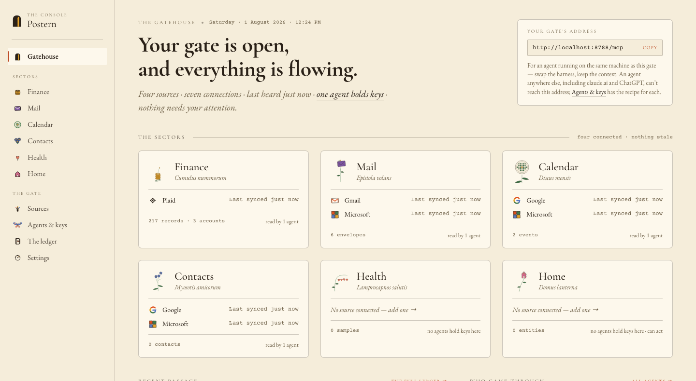
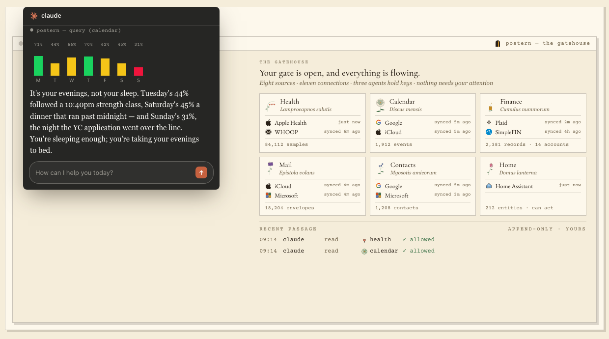

# Postern

**The Personal Context Gateway.** Connect the sectors of your life once — finance, health, mail, contacts, calendar, home — and reach them from *any* agent through one surface. Read them, and act on them where the source allows.

Postern runs on your own machine, and there is nothing in the middle: no account to create, no service to sign up for, no model provider in the loop, and no correlation happening across your domains behind your back. Nothing leaves the box you started it on unless you ask it to.

**[getpostern.com](https://getpostern.com)** is the front door — the live demo, and a field guide for every provider.



*The Gatehouse — a real gate with four sources connected, everything freshly synced. This is `localhost:8787` once your first sources are in.*

## Set it up

Postern runs on any computer that stays on — the one in front of you, or a spare machine at home. You need one thing installed first: [Docker](https://docs.docker.com/get-docker/) (free, and its site walks you through it). After that it's three lines and about five minutes.

In plain words, the three lines: fetch Postern, give its database a password of its own, start everything.

```bash
git clone https://github.com/getpostern/postern.git && cd postern
echo "POSTGRES_PASSWORD=$(openssl rand -hex 24)" > .env
docker compose up -d
```

Now open **<http://localhost:8787>** in your browser. That page is the Console — your gate's control room. It walks you through connecting your first source, and [the field guides](https://getpostern.com/guides) walk every provider screen by screen, with pictures.

Three things worth knowing, each the answer to a real question:

- **"Why the password line?"** The database keeps the first password it is ever given, so it must live in the `.env` file, where every later start finds the same one — never typed in front of the command. Letters and numbers only; the line above generates a safe one for you.
- **"I installed it on one machine — how do I use it from my laptop?"** The Console answers only on the machine it runs on. That is the security model, not a limitation: your gate's controls should not be reachable over the network. One command brings them to wherever you are — `ssh -N -L 127.0.0.1:8787:127.0.0.1:8787 <your-box>` — leave it running, and `http://localhost:8787` opens on your laptop too. Everything *else* reaching the gate from outside runs on [Tailscale](https://tailscale.com): your own devices (your phone's health data, agents on your laptop) over your private tailnet, and hosted agents — claude.ai, ChatGPT — over its Funnel, a public HTTPS address where TLS still ends on your machine. All of it opt-in, none of it on by default; [`docs/SETUP.md`](docs/SETUP.md) § Remote access walks each tier.
- **"What did I just install?"** One published, signed image (`ghcr.io/getpostern/postern`) and a database, listening only on your own machine (`127.0.0.1`), nothing else. Only `docker-compose.yml` is truly needed — download that one file if you would rather not clone.

Building from source instead? `docker-compose.dev.yml` carries the `build:` key, and [`CONTRIBUTING.md`](CONTRIBUTING.md) has the rest. The complete self-host path — every provider, every trap — is [`docs/SETUP.md`](docs/SETUP.md); if an agent is doing the setup on your behalf, hand it [`AGENTS.md`](AGENTS.md) — the same path written as a contract, each step marked human-required or automatable.

## What it removes

Postern is best understood by what stops being your problem.

- **API discovery.** Every provider is a different API with a different auth dance, a different pagination model, a different idea of what a "transaction" is and which direction money flows. Today an agent pays that cost at *runtime* — reading docs, guessing field names, discovering the sign convention by getting it wrong. Postern pays it once, in code, and publishes a typed schema with the traps written down: `get_schema` carries the notes and per-field semantics an agent must read *before* composing a filter.
- **Per-agent re-integration.** Every new agent, harness or assistant currently re-does the whole integration: its own OAuth app, its own tokens, its own connectors, its own permission model. With Postern you connect a source once and mint a scoped key; the next agent gets the same context in one step and inherits the same grants and the same audit trail.
- **The harness ceiling.** Because the integration lives *in* the harness, leaving the harness means leaving the context. Postern is harness-agnostic on purpose: swap Claude for something else, add a second agent, move to a different client — the context, the capabilities, the permissions and the log stay where they are, because they were never inside the agent.

What it deliberately does **not** do: no LLM runs inside the gateway, no cross-domain correlation, no derived facts written back into your store. It is a faithful cache and a dispatcher. The agent reasons; Postern authenticates, normalizes, stores, serves, and dispatches.

## Three properties

- **One place.** One surface, one grant. A granted sector covers reading *and* acting across every provider in it.
- **Lightning fast.** Reads come from a local cache in milliseconds. `fetch_live` is the one read path that touches a source, and actions add no gateway overhead around the single unavoidable dispatch.
- **Harness-agnostic.** MCP, REST, or whatever comes next — every edge is an adapter over the same seven core primitives. There is never a second implementation.

## The agent surface

Seven primitives, not a tool per question. The MCP adapter maps 1:1 onto them; the REST mirror serves the reads.

| primitive | what it does |
|---|---|
| `describe_context()` | connected sectors + per-connection freshness |
| `get_schema(sector?)` | the queryable objects and fields per sector, with the semantics notes |
| `query({sector, where?, select?, limit?})` | structured read, fields validated against the schema, results capped |
| `get_record(sector, id)` | drill to the raw source record |
| `fetch_live` | bounded live pull beyond the cache — sector sync-now or per-record drill |
| `list_actions(sector?)` | the cache-served action catalog (connectors that support acting) |
| `invoke_action(...)` | dispatch one action to the source (deterministic target resolution) |

`query` and `get_record` are always cache-only and instant. `query` reads **one** sector — there are no cross-sector joins, by design; an agent fans out and correlates on its own side.

From the agent's side it looks like this — one gate, three agents each holding its own key, every read landing in the owner's ledger:

[](https://getpostern.com)

*From the live demo — it moves at [getpostern.com](https://getpostern.com).*

## What connects today

| source | how you connect it | sectors | screen by screen |
|---|---|---|---|
| SimpleFIN | paste a setup token | finance | [field guide](https://getpostern.com/guides/simplefin) |
| Plaid | your own Plaid app + a hosted Link session | finance | [field guide](https://getpostern.com/guides/plaid) |
| iCloud | Apple ID + an app-specific password | mail, calendar, contacts | [field guide](https://getpostern.com/guides/icloud) |
| Gmail | address + an app password (IMAP) | mail | [field guide](https://getpostern.com/guides/gmail) |
| Microsoft | your own OAuth app | mail, calendar, contacts | [field guide](https://getpostern.com/guides/microsoft) |
| Google | your own OAuth app | calendar, contacts | [field guide](https://getpostern.com/guides/google) |
| WHOOP | your own OAuth app | health | [field guide](https://getpostern.com/guides/whoop) |
| Apple Health | a Shortcut on your iPhone pushes to your gateway | health | [field guide](https://getpostern.com/guides/apple-health) |
| Home Assistant | instance URL + a long-lived token | home | [field guide](https://getpostern.com/guides/home-assistant) |

Home Assistant is the one that also **acts**: the action catalog is served from the cache and dispatched through `invoke_action`. Adding a source is a connector plus a schema-registry entry and a migration — never a control-plane change. See [`CONTRIBUTING.md`](CONTRIBUTING.md).

## License and model

The whole gateway is **open source under [AGPL-3.0-or-later](LICENSE)** — the engine, every connector, both agent edges, the Console. Nothing here is a crippled tier: the open core is the product, not a demo of it.

The paid surfaces sit *beside* it, not inside it — a contextual-memory tier, a person-to-person trust layer, and hosted convenience for people who would rather not run a box. None of them is a gate on anything in this repository.

Contributions are inbound under the same license, by DCO sign-off — see [`CONTRIBUTING.md`](CONTRIBUTING.md). The Postern name and door mark are **not** licensed with the code; see [`TRADEMARK.md`](TRADEMARK.md).

## A note on `PCI_` and `pci`

Environment variables, the default database name and some log prefixes still carry a `PCI_` / `pci` prefix from the project's working name before it became Postern. They are wire identifiers, not branding, and renaming them would break every existing install for no functional gain — so they stay. If you see `PCI_MASTER_KEY` or a `pci` database, that is Postern.

## Where the detail lives

| you want | read |
|---|---|
| to install it and connect your sources | [`docs/SETUP.md`](docs/SETUP.md) |
| every provider console, screen by screen — with the traps | [getpostern.com/guides](https://getpostern.com/guides) |
| an agent to do the setup | [`AGENTS.md`](AGENTS.md) |
| you *are* an agent, connecting to someone's gate | [getpostern.com/for-agents](https://getpostern.com/for-agents) |
| to know exactly what is trusted, and what is not | [`SECURITY.md`](SECURITY.md) |
| to reach your gateway from away | [`docs/runbooks/remote-access.md`](docs/runbooks/remote-access.md) |
| to know *why* something has the shape it has | [`docs/specs/decisions/`](docs/specs/decisions/) — the ADRs, indexed |
| to build a connector or send a patch | [`CONTRIBUTING.md`](CONTRIBUTING.md) |
| the architecture end to end | [`docs/architecture.html`](docs/architecture.html) |
